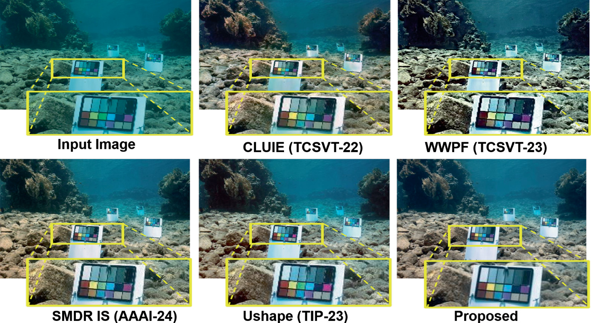
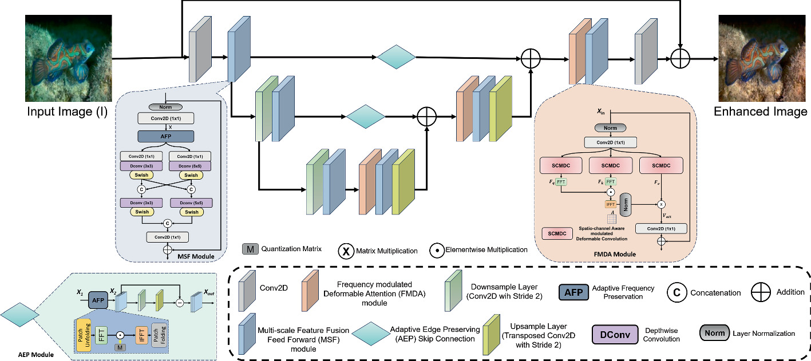
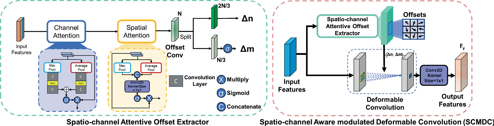
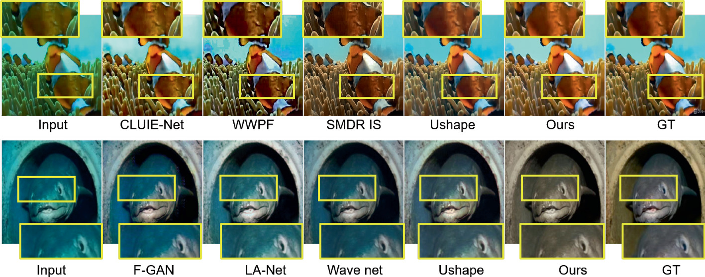
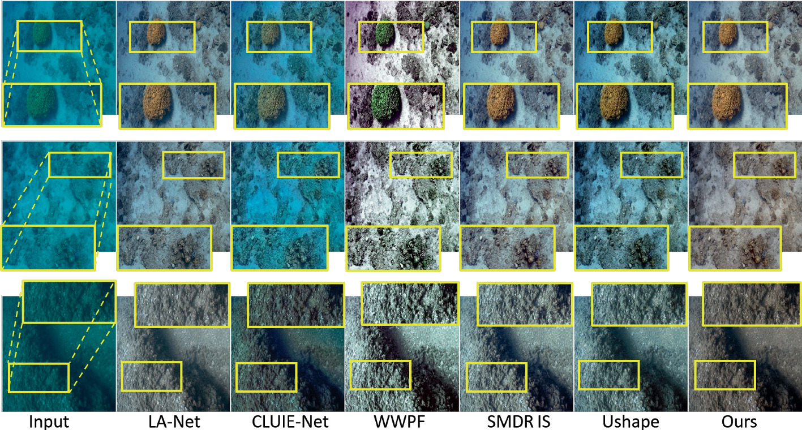

<h1 align="center">
<strong>Frequency Modulated Deformable Transformer for Underwater Image Enhancement</strong>
</h1>

<div align="center">

<a href="https://git.io/typing-svg">

</a>

[](https://link.springer.com/chapter/10.1007/978-3-031-78125-4_9)
[](https://link.springer.com/chapter/10.1007/978-3-031-78125-4_9)
[](#%EF%B8%8F-installation)
[](#overview)
[](https://visitorbadge.io/status?path=https%3A%2F%2Fgithub.com%2Fadinathdukre%2FFMDTUIE)

<h3>📄 <a href="https://link.springer.com/chapter/10.1007/978-3-031-78125-4_9">Paper</a> &nbsp;|&nbsp; 🧠 <a href="#-method">Method</a> &nbsp;|&nbsp; 🏆 <a href="#-results">Results</a> &nbsp;|&nbsp; ⚡ <a href="#-testing">Test</a> &nbsp;|&nbsp; 📝 <a href="#-citation">Cite</a></h3>

<b><a href="https://github.com/adinathdukre">Adinath Dukre</a>, Vivek Deshmukh, Ashutosh Kulkarni, Shruti Phutke, Santosh Kumar Vipparthi, Anil B. Gonde, Subrahmanyam Murala</b>

International Conference on Pattern Recognition (ICPR) 2024

</div>

## 🔥 News
- **[Nov 2026]** 🚀 Testing code and the pretrained UIEB checkpoint are released.
- **[Dec 2024]** 🎉 Our paper is published in the ICPR 2024 proceedings (Springer LNCS, pp. 121–136).

## Overview
Official PyTorch testing code for **Frequency Modulated Deformable Transformer for Underwater Image Enhancement** (ICPR 2024).

Underwater images suffer from refraction, back-scattering and absorption, which cause colour casts, blur and low visibility. These degradations hurt downstream vision tasks on autonomous underwater vehicles. Existing enhancement methods restore global appearance but fail to keep **localized fine edges** together with **true colours**. We propose a frequency modulated deformable transformer that reconstructs fine texture in the frequency domain, focuses its deformable sampling on contextually relevant regions, and carries edge information from shallow to deep layers.

<p align="center">

<em><b>Fig. 1.</b> Sample visual results of the proposed and existing state-of-the-art methods. Existing methods fail to generate localized edges, whereas the proposed approach produces effective localized edges and true colour.</em>
</p>

## 📖 Contents
- [🧠 Method](#-method)
- [🏆 Results](#-results)
- [⛏️ Installation](#️-installation)
- [⚡ Testing](#-testing)
- [🗂️ Repository Structure](#️-repository-structure)
- [📝 Citation](#-citation)
- [📚 Acknowledgments](#-acknowledgments)
- [📨 Contact](#-contact)

## 🧠 Method

<p align="center">

<em><b>Fig. 2.</b> Architecture of the proposed frequency modulated deformable transformer for underwater image enhancement.</em>
</p>

- **Multi-scale Feature Fusion feed-forward (MSF) module.** Extracts features with parallel 3×3 and 5×5 depth-wise branches that are cross-fused, preceded by an **Adaptive Frequency Preservation (AFP)** step that re-weights each patch's spectrum with a learnable quantization matrix.
- **Frequency Modulated Deformable Attention (FMDA) module.** Queries, keys and values come from deformable convolutions; query–key interaction is computed in the frequency domain (patch-wise FFT) to reconstruct fine-level texture in the restored image.
- **Spatio-Channel aware Modulated Deformable Convolution (SCMDC).** A spatio-channel attentive offset extractor applies channel and spatial attention before predicting offsets and modulation masks, so deformable sampling stays on relevant structures and colour cues.
- **Adaptive Edge Preserving (AEP) skip connections.** Pass high-frequency (edge) features from the shallow encoder layers to the deeper decoder layers.

<p align="center">

<em><b>Fig. 3.</b> The proposed spatio-channel attentive offset extractor and spatio-channel aware deformable convolution.</em>
</p>

## 🏆 Results

### Quantitative

Full-reference results on UIEB and EUVP (↑ higher is better, ↓ lower is better):

| Method | Venue | UIEB PSNR ↑ | UIEB SSIM ↑ | UIEB LPIPS ↓ | EUVP PSNR ↑ | EUVP SSIM ↑ | EUVP LPIPS ↓ |
|---|:---:|:---:|:---:|:---:|:---:|:---:|:---:|
| LANet | RAL-22 | 24.05 | 0.90 | 0.13 | 25.82 | 0.86 | 0.28 |
| CLUIE | TCSVT-22 | 20.37 | 0.89 | 0.18 | – | – | – |
| WaveNet | TMCCA-23 | 21.57 | 0.80 | 0.12 | 28.62 | 0.83 | 0.24 |
| WWPF | TCSVT-23 | 18.59 | 0.79 | 0.22 | – | – | – |
| U-shape | TIP-23 | 21.39 | 0.85 | 0.24 | 26.77 | 0.87 | 0.26 |
| SMDR-IS | AAAI-24 | 23.71 | 0.92 | 0.14 | – | – | – |
| **Ours** | ICPR-24 | **25.79** | **0.95** | **0.11** | **30.90** | **0.92** | **0.22** |

The paper also reports non-reference metrics (UIQM, UCIQE, UICM, NIQE) on Color-Checker and Sea-thru, and ablations of the MSF module, attention type, offset extractor and skip connections.

### Qualitative

<p align="center">

<em><b>Fig. 5.</b> Qualitative comparison with LA-Net, F-GAN, CLUIE, WaveNet, WWPF, SMDR-IS and U-shape on UIEB (top row) and EUVP (bottom row).</em>
</p>

<p align="center">

<em><b>Fig. 6.</b> Qualitative comparison on the real-world Sea-thru dataset with LA-Net, WaveNet, CLUIE, WWPF, SMDR-IS and U-shape.</em>
</p>

## ⛏️ Installation

```bash
git clone https://github.com/adinathdukre/FMDTUIE.git
cd FMDTUIE
pip install -r requirements.txt
```

The code needs PyTorch and torchvision (for `torchvision.ops.DeformConv2d`). For GPU execution, install a PyTorch build that matches your CUDA version. It also runs on CPU.

## ⚡ Testing

The pretrained UIEB checkpoint is included at `./checkpoint/UIEB.pth` (≈6 MB), and five sample UIEB images are included under `./datasets/images/`.

**Sample images (paired).** Each sample file holds the degraded input (left) and the reference (right) side by side. Run:

```bash
python test.py
```

Enhanced images are saved to `./result/UIEB/`, and the mean PSNR/SSIM against the references is printed. On the five bundled samples this gives PSNR 25.16 dB and SSIM 0.948.

**Your own underwater images.** Put plain (unpaired) images in a folder and run:

```bash
python test.py --mode single --data_path_test /path/to/images --data_name my_images --keep_size
```

Useful options:

| Argument | Default | Description |
|---|---|---|
| `--data_path_test` | `./datasets/images/` | folder of test images (`.png`, `.jpg`, …) |
| `--mode` | `paired` | `paired`: input and GT side by side, reports PSNR/SSIM; `single`: plain images |
| `--size` | `512` | square test resolution; must be divisible by 32 |
| `--keep_size` | off | resize each output back to the resolution of its input |
| `--model_file` | `./checkpoint/UIEB.pth` | checkpoint to load |
| `--save_path` / `--data_name` | `result` / `UIEB` | outputs go to `<save_path>/<data_name>/` |
| `--device` | `cuda` if available, else `cpu` | e.g. `--device cuda:1` |

> [!NOTE]
> The network works on square inputs whose side is divisible by 32, so every image is resized to `--size × --size` (512×512 by default, as in the paper) before enhancement.

## 🗂️ Repository Structure

```text
FMDTUIE/
├── model.py             # network: MSF (MSFL), FMDA (DFSL), SCMDC (SepConv2d), AEP skip (Fuse)
├── test.py              # inference, PSNR/SSIM for paired images
├── utils.py             # test dataset (paired / single images)
├── checkpoint/
│   └── UIEB.pth         # pretrained weights (UIEB)
├── datasets/images/     # sample UIEB images (input | GT)
├── docs/assets/         # figures used in this README
└── requirements.txt
```

## 📝 Citation

If you find our paper and code useful in your research, please cite:

```bibtex
@inproceedings{dukre2024fmdt,
  title     = {Frequency Modulated Deformable Transformer for Underwater Image Enhancement},
  author    = {Dukre, Adinath and Deshmukh, Vivek and Kulkarni, Ashutosh and Phutke, Shruti and Vipparthi, Santosh Kumar and Gonde, Anil B. and Murala, Subrahmanyam},
  booktitle = {Pattern Recognition (ICPR 2024)},
  series    = {Lecture Notes in Computer Science},
  pages     = {121--136},
  year      = {2025},
  publisher = {Springer Nature Switzerland},
  doi       = {10.1007/978-3-031-78125-4_9}
}
```

## 📚 Acknowledgments

Parts of this code build on [Restormer](https://github.com/swz30/Restormer) and [FFTformer](https://github.com/kkkls/FFTformer). We thank their authors for sharing their code. We also thank the authors of the UIEB, EUVP, Color-Checker and Sea-thru datasets.

## 📨 Contact
For questions or collaboration, please open an [issue](https://github.com/adinathdukre/FMDTUIE/issues) or reach out to [Adinath Dukre](https://github.com/adinathdukre).
